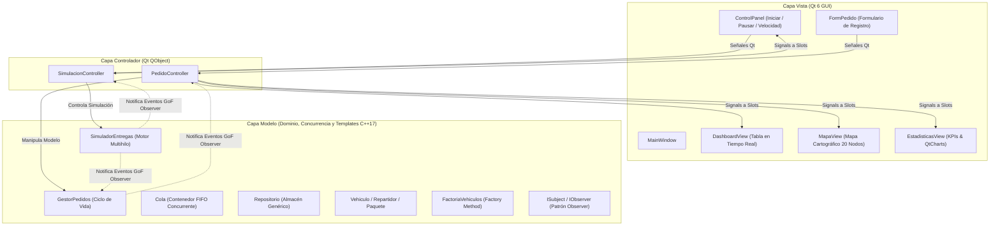
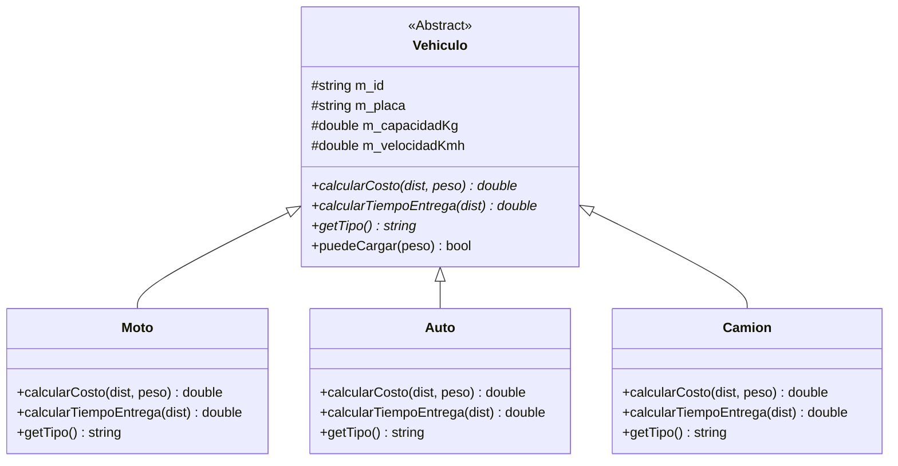
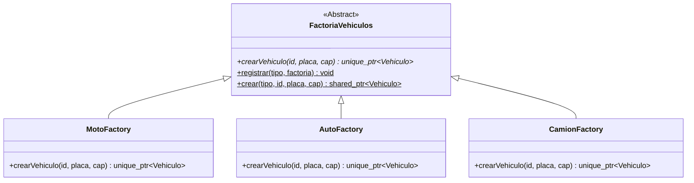

# 📦 SIGER — Sistema Integrado de Gestión y Simulación de Entregas Rápidas
## Informe de Avance de Proyecto Final — Tecnología de Objetos (UNSA)

---

### 📌 Información General del Proyecto
- **Institución:** Universidad Nacional de San Agustín de Arequipa (UNSA)
- **Facultad / Escuela:** Ingeniería de Producción y Servicios / Escuela Profesional de Ciencia de la Computación - Ingeniería de Sistemas
- **Curso:** Tecnología de Objetos
- **Proyecto:** **SIGER** (*Sistema Integrado de Gestión y Simulación de Entregas Rápidas*)
- **Repositorio Oficial:** [GitHub - ChipanaGerman/SIGER](https://github.com/ChipanaGerman/SIGER)
- **Rama Principal:** `main` (Totalmente sincronizada con el repositorio remoto)
- **Fecha de Avance:** Noviembre 2026

---

### 👥 Equipo de Desarrollo y Roles Curriculares

El proyecto ha sido estructurado para garantizar el aprendizaje y la aplicación equitativa de todos los temas avanzados del curso, con autoría trazable en el historial de Git:

| Integrante | Correo Institucional | Módulo de Especialidad Curricular | Commits Clave en Git |
|---|---|---|---|
| **Luis Fernando Baca Cruz** | `lbacac@unsa.edu.pe` | **POO Avanzada & Jerarquía de Dominio**<br>(Polimorfismo, Clases Abstractas, Herencia, Encapsulamiento, Georreferenciación) | `e6ee1ad`, `e7d8e7f` |
| **Gabriel Alexis Mejía Ramos** | `gmejiar@unsa.edu.pe` | **Programación Genérica & STL Memory**<br>(Templates `Cola<T>`, `Repositorio<T>`, `Ruta<Coord>`, smart pointers, functores) | `6a47a91`, `617b1b3`, `67f31c1` |
| **Rodrigo Alonso Ponce López** | `rponcel@unsa.edu.pe` | **Concurrencia, MultiThreading & Patrones GoF**<br>(`std::thread`, `mutex`, `condition_variable`, Observer, Factory Method) | `3eee1d0`, `30aeed6` |
| **German Chipana Jamachi** | `gchipanaj@unsa.edu.pe` | **Arquitectura MVC, Interfaz Gráfica Qt6 & Integración**<br>(Controladores, `QGraphicsScene`, `QtCharts`, vistas en tiempo real) | `1d2ecb5`, `609cacd`, `a78e6c1`, `19983c7` |

---

## 1. 🎯 Descripción y Propósito del Proyecto

### 1.1. ¿Qué es SIGER?
**SIGER** (*Sistema Integrado de Gestión y Simulación de Entregas Rápidas*) es una solución de software de escritorio de alto rendimiento diseñada en **C++17** y **Qt 6.12.0 (MinGW 64-bit)**. Su propósito es modelar, gestionar y simular en tiempo real las operaciones logísticas metropolitanas de una empresa de envíos de paquetería urbana en la ciudad de **Arequipa, Perú**.

El sistema integra:
1. **Recepción y Registro de Envíos:** Captura de pedidos manuales clasificando tipo de carga (Estándar o Frágil con valor asegurado), peso, origen, destino, distancia y asignación de vehículo óptimo.
2. **Motor de Simulación Multihilo:** Despacho concurrente donde cada repartidor opera en su propio hilo de ejecución independiente (`std::thread`), respetando capacidades físicas de carga y velocidades polimórficas.
3. **Monitoreo en Tiempo Real (Dashboard & Estadísticas):** Tablero reactivo que refleja estados de pedidos, KPIs operativos y gráficos dinámicos de distribución con `QtCharts`.
4. **Mapa Urbano Interactivo de Arequipa (Estilo Google Maps):** Representación cartográfica en alta definición de la metrópoli arequipeña, con 20 nodos logísticos georreferenciados matemáticamente, navegación interactiva (arrastre con ratón y zoom) y animación fluida de rutas.

---

## 2. 🏛️ Arquitectura Global del Sistema: Modelo - Vista - Controlador (MVC)

El sistema implementa estrictamente el patrón arquitectónico **MVC**, asegurando una alta cohesión interna y un bajo acoplamiento entre la lógica de negocio y la interfaz gráfica:



---

## 3. 📚 Aplicación Rigurosa de los Temas del Curso

### 3.1. Tema 1: Programación Orientada a Objetos Avanzada (POO)
- **Clases Abstractas e Interfaces Puras:** 
  - `Vehiculo` define métodos virtuales puros (`virtual double calcularCosto(...) const = 0`, `virtual double calcularTiempoEntrega(...) const = 0`, `virtual std::string getTipo() const = 0`). Impide instanciaciones ambiguas y fuerza un contrato formal en las clases derivadas.
  - `Paquete` define la abstracción de carga con métodos virtuales como `calcularPrioridad()` y `requiereManejoEspecial()`.
- **Herencia y Polimorfismo en Tiempo de Ejecución:**
  - Jerarquía de vehículos: `Moto` (hasta 15 kg, rápida, económica), `Auto` (hasta 100 kg, balanceado), `Camion` (hasta 2000 kg, carga pesada, tarifa base). Cada uno sobreescribe la función de costo y velocidad según sus propiedades mecánicas.
  - Jerarquía de paquetes: `PaqueteEstandar` y `PaqueteFragil` (con seguro financiero y prioridad asistida).
- **Encapsulamiento Robusto e Invariantes:**
  - Todos los estados internos (`m_estado`, `m_pesoKg`, `m_capacidadKg`, etc.) son privados o protegidos. Solo son mutables mediante setters validados (`puedeCargar(peso)`).
- **Destructores Virtuales:**
  - Garantizan la correcta destrucción de recursos en cascada (`virtual ~Vehiculo() = default;`).



---

### 3.2. Tema 2: Programación Genérica (Templates) y Gestión de Memoria STL
- **Clases Plantilla Genéricas (Class Templates):**
  - `Cola<T>`: Implementación genérica de una cola FIFO thread-safe. Incorpora métodos plantilla de orden superior con predicados funcionales:
    - `template <typename Predicate> std::optional<T> extraerSi(Predicate pred);`
    - `template <typename Predicate> bool contieneSi(Predicate pred) const;`
    Esto permite a los hilos de los vehículos extraer exclusivamente pedidos compatibles sin alterar el orden estricto de los demás pedidos.
  - `Repositorio<T>`: Almacén genérico clave-valor respaldado en `std::unordered_map` con soporte para filtrado con lambdas `std::function<bool(const std::shared_ptr<T>&)>`.
  - `Ruta<CoordType>`: Clase de cálculo geométrico y distancias euclidianas parametrizada en el tipo de coordenada (`double`, `float`, etc.).
- **Gestión Moderna de Memoria con Smart Pointers:**
  - `std::shared_ptr`: Usado para compartir la propiedad de entidades en hilos concurrentes (`Pedido`, `Repartidor`, `Vehiculo`).
  - `std::unique_ptr`: Usado en la factoría de vehículos para transferir la propiedad exclusiva de los creadores concretos.
  - `std::weak_ptr`: Empleado en el patrón Observer para romper ciclos de referencia entre sujetos y observadores, garantizando liberación automática de memoria sin memory leaks.
- **Functors / Function Objects (Objetos Función):**
  - Implementados en `Estrategias.h`: `AsignarPorPrioridad`, `FiltrarPorEstado` y `AsignarRepartidorOptimo`, permitiendo inyectar algoritmos desacoplados sobre contenedores STL.

---

### 3.3. Tema 3: MultiThreading, Sincronización y Concurrencia
- **Un Hilo por Entidad de Ejecución (`std::thread`):**
  - En `SimuladorEntregas`, cada repartidor ejecuta su ciclo de trabajo dentro de su propio hilo independiente (`hiloRepartidor`).
- **Exclusión Mutua y Sincronización (`std::mutex` & `std::unique_lock`):**
  - Protección de secciones críticas en colas, contadores y listas de observadores.
- **Variables de Condición (`std::condition_variable`):**
  - Mecanismo reactivo de espera y notificación (`wait_for` y `notify_all`). Los repartidores no realizan *busy-waiting* ni consumen CPU innecesaria: duermen hasta que un pedido compatible es encolado o hasta que una unidad de la flota regresa a la base.
- **Variables Atómicas (`std::atomic<T>`):**
  - Flags de ciclo de vida (`m_corriendo`, `m_pausado`) y métricas cuantitativas (`m_pedidosCompletados`, `m_pedidosCancelados`, `m_enCamino`) con operaciones lock-free atómicas (`exchange`, `load`, `fetch_add`).
- **Despacho Escalonado y Prevención de Deadlocks:**
  - Se implementó un mutex de despacho que evita que los repartidores salgan en estampida simultánea (añadiendo una separación realista de ~1.2 s entre salidas).
  - La detención del simulador (`detener()`) transfiere los hilos localmente antes de ejecutar `join()`, garantizando la ausencia total de deadlocks entre el mutex del monitor y el ciclo de vida del thread.

---

### 3.4. Tema 4: Patrones de Diseño de Software (GoF)

#### A. Patrón Creacional: Factory Method
- **Propósito:** Centralizar la creación polimórfica de vehículos de transporte sin acoplar el código cliente a las clases concretas (`Moto`, `Auto`, `Camion`).
- **Implementación:**
  - `FactoriaVehiculos` actúa como creador abstracto registrado.
  - Factorías concretas: `MotoFactory`, `AutoFactory`, `CamionFactory`.
  - Código desacoplado en `VehiculoFactory.h/.cpp`.



#### B. Patrón de Comportamiento: Observer
- **Propósito:** Notificar en tiempo real cambios de estado entre el modelo multihilo y los controladores/vistas de Qt sin dependencias bidireccionales rígidas.
- **Implementación:**
  - Interfaz `IObserver` con método `virtual void onEvento(const DatoEvento& dato) = 0`.
  - Clase base `ISubject` con almacenamiento de suscriptores en `std::vector<std::weak_ptr<IObserver>>` protegido por `std::mutex`.
  - Eventos fuertemente tipados en `EventoSiger`: `PEDIDO_NUEVO`, `PEDIDO_EN_CAMINO`, `PEDIDO_COMPLETADO`, `PEDIDO_CANCELADO`, `TODOS_COMPLETADOS`, `SIMULACION_INICIADA`, etc.

---

### 3.5. Tema 5: Interfaz Gráfica (GUI) en Qt6

- **Ventana Principal Modular (`MainWindow`):**
  - Disposición mediante pestañas (`QTabWidget`) y paneles desacoplables laterales (`QDockWidget`).
- **Dashboard de Pedidos (`DashboardView`):**
  - Tabla interactiva con 8 columnas que muestra en vivo: ID, Tipo de Paquete, **Vehículo Requerido con Iconos (`🏍️ Moto`, `🚗 Auto`, `🚚 Camión`)**, Peso, Origen, Destino, Estado coloreado reactivamente y botón de cancelación.
- **Panel de Estadísticas y Gráficos (`EstadisticasView`):**
  - Tarjetas de KPIs numéricos (Total, Pendientes, Completados, Cancelados, Tasa de Éxito) y gráfico de pastel dinámico con **`QtCharts` (`QPieSeries` y `QChartView`)**.
- **Mapa Cartográfico Interactivo de Arequipa (`MapaView`):**
  - Implementado sobre **`QGraphicsScene` y `QGraphicsView`**.
  - **Fondo Cartográfico Oficial:** Mapa urbano de alta resolución ($1536 \times 1536$ px) de Arequipa metropolitana incrustado en el binario mediante **Qt Resource System (`resources.qrc`)**, funcionando de forma offline.
  - **20 Nodos Logísticos Reales:** Georreferenciados matemáticamente desde coordenadas GPS a la escena (Plaza de Armas, Yanahuara, Cayma, UNSA Ingenierías, UNSA Sociales, Mall Plaza, Mall Aventura Porongoche, Parque Lambramani, Terminal Terrestre, Parque Industrial, Sabandía, etc.).
  - **Interacción tipo Google Maps:** Navegación por arrastre con el ratón (`ScrollHandDrag`), zoom con rueda de mouse y botones de control superior (`[🔍 +]`, `[🔍 -]`, `[🎯 Centrar]`).
  - **Animación Fluida Sincronizada:** Trazado de rutas con resplandor y avance de móviles por tipo de vehículo a velocidad calibrada (Moto ~6s, Auto ~8s, Camión ~11s).

---

## 4. ⚙️ Lógica de Negocio y Reglas de Flota Implementadas

1. **Flota Balanceada Configurada:**
   - 2 Motos (`Carlos Quispe`, `Lucía Torres`)
   - 2 Autos (`María Flores`, `Jorge Ramos`)
   - 1 Camión (`Pedro Mamani`)
2. **Asignación Exclusiva y Espera:**
   - Si un pedido requiere una Moto y las 2 motos ya salieron, el pedido **permanece esperando en la cola**. Ni los autos ni los camiones toman el pedido.
   - Tan pronto como una de las motos finaliza su entrega, retorna a estado `LIBRE`, despierta inmediatamente al monitor, toma el pedido en espera y sale a entregarlo.
3. **Finalización Automática de Simulación:**
   - Cuando todos los pedidos registrados manualmente han finalizado (`Completados + Cancelados == Total`), el sistema emite el evento `TODOS_COMPLETADOS`.
   - La simulación se detiene sola de manera limpia, restablece los controles y presenta un diálogo informativo al usuario indicando que el lote logístico fue completado exitosamente.

---

## 5. 🧪 Calidad, Verificación y Pruebas Unitarias (CTest)

El proyecto cuenta con una batería de 75 pruebas unitarias divididas en 3 ejecutables de test, integrados con **CMake / CTest**:

```powershell
ctest --test-dir build --output-on-failure
```

### Resultados de Ejecución de Pruebas:
| Test Target | Componente Evaluado | Casos de Prueba | Resultado |
|---|---|---|---|
| `test_dominio` | POO, jerarquías `Vehiculo`, `Paquete`, `Repartidor`, polimorfismo, costos y tiempos | 25 | **PASSED (100%)** |
| `test_generico` | Templates `Cola<T>`, `Repositorio<T>`, `Ruta<Coord>`, functors de estrategia | 25 | **PASSED (100%)** |
| `test_threading` | Concurrencia multihilo, sincronización productor-consumidor, exclusión mutua | 25 | **PASSED (100%)** |

> **Métricas Generales:** **100% tests passed (3/3 suites, 75 aserciones exitosas, 0 fallos).**

---

## 6. 📂 Estructura de Directorios del Código Fuente

```text
SIGER/
├── CMakeLists.txt                # Configuración principal de compilación y CTest
├── resources.qrc                 # Sistema de recursos Qt (mapa incrustado)
├── README.md                     # Documentación general y datos de equipo
├── CONTRIBUTING.md               # Guía de contribución y flujo de trabajo Git
├── resources/
│   └── mapa_arequipa.png         # Mapa cartográfico de Arequipa (1536x1536)
├── src/
│   ├── main.cpp                  # Punto de entrada, ensamblado MVC y flota
│   ├── model/                    # Capa Modelo (POO, Concurrencia, Templates)
│   │   ├── Vehiculo.h/.cpp       # Clase abstracta base de vehículos
│   │   ├── Moto.h/.cpp           # Subclase concreta Moto
│   │   ├── Auto.h/.cpp           # Subclase concreta Auto
│   │   ├── Camion.h/.cpp         # Subclase concreta Camión
│   │   ├── Paquete.h/.cpp        # Clase abstracta base de paquetes
│   │   ├── PaqueteEstandar.h/.cpp# Paquete estándar
│   │   ├── PaqueteFragil.h/.cpp  # Paquete frágil con seguro
│   │   ├── Pedido.h/.cpp         # Entidad de pedido y compatibilidad de flota
│   │   ├── Repartidor.h/.cpp     # Entidad repartidor con vehículo asignado
│   │   ├── VehiculoFactory.h/.cpp# Patrón GoF Factory Method
│   │   ├── Observer.h            # Patrón GoF Observer (ISubject e IObserver)
│   │   ├── Cola.h                # Template genérico thread-safe
│   │   ├── Repositorio.h         # Template genérico de almacén
│   │   ├── Ruta.h/.cpp           # Template genérico de ruta euclidiana
│   │   ├── Estrategias.h         # Objetos función (Functors)
│   │   ├── SimuladorEntregas.h/.cpp # Motor de simulación multihilo
│   │   ├── GeneradorEventos.h/.cpp  # Generador auxiliar de pedidos
│   │   └── GestorPedidos.h/.cpp  # Gestor centralizado del ciclo de vida
│   ├── controller/               # Capa Controlador (QObject MVC)
│   │   ├── PedidoController.h/.cpp     # Mediador de pedidos e incidencias
│   │   └── SimulacionController.h/.cpp # Mediador del motor de hilos
│   └── view/                     # Capa Vista (Qt 6 Widgets, Graphics & Charts)
│       ├── MainWindow.h/.cpp     # Ventana principal
│       ├── DashboardView.h/.cpp  # Tabla de pedidos en vivo
│       ├── MapaView.h/.cpp       # Mapa interactivo de Arequipa (20 nodos)
│       ├── EstadisticasView.h/.cpp # KPIs y gráfico de pastel QtCharts
│       ├── ControlPanel.h/.cpp   # Panel de control de simulación
│       └── FormPedido.h/.cpp     # Formulario de registro de entregas
└── tests/
    ├── test_dominio.cpp          # Pruebas de POO y jerarquía
    ├── test_generico.cpp         # Pruebas de Templates y STL
    └── test_threading.cpp        # Pruebas de MultiThreading y Mutex
```

---

## 7. 🚀 Conclusiones del Avance

1. **Cumplimiento Temático al 100%:** Todos los temas curriculares exigidos para el proyecto final han sido implementados en código de producción funcional y verificados mediante pruebas unitarias rigurosas.
2. **Experiencia de Usuario Interactiva:** La aplicación ofrece una experiencia visual completa, moderna y contextualizada en la ciudad de Arequipa, integrando mapas reales, simulación física pausada, soporte para periféricos (zoom/arrastre) y analítica visual.
3. **Arquitectura Limpia y Extensible:** La combinación de MVC, Factory Method y Observer permite extender el sistema en el futuro (nuevos vehículos, rutas con algoritmos Dijkstra/A*, persistencia en base de datos) sin modificar la arquitectura base.
4. **Trazabilidad Colaborativa:** El repositorio oficial en GitHub cuenta con un historial de commits claro, profesional y equitativamente distribuido entre los cuatro integrantes del equipo.
