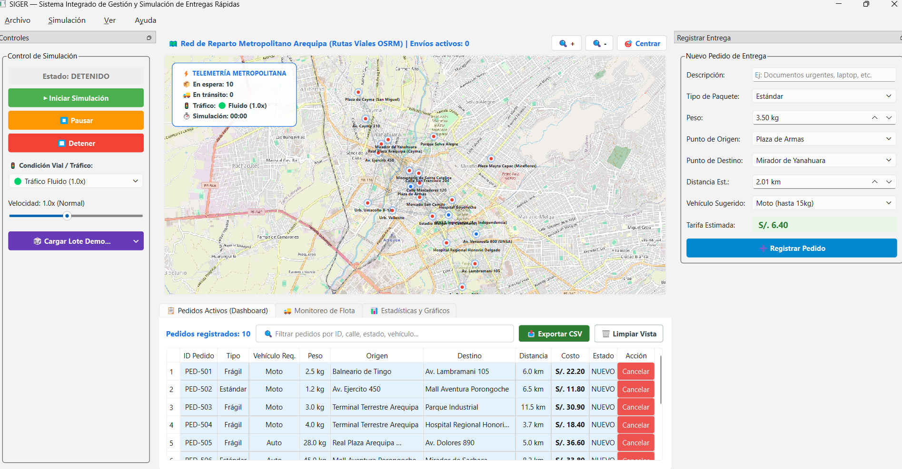
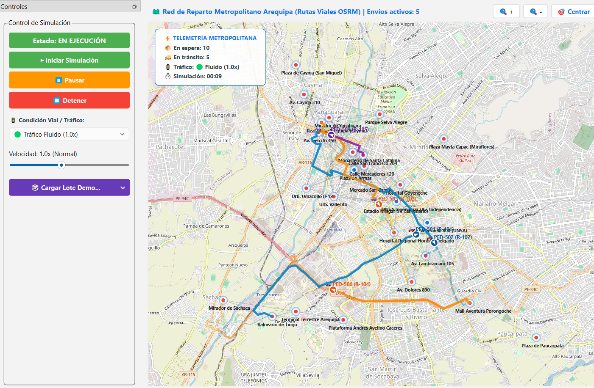
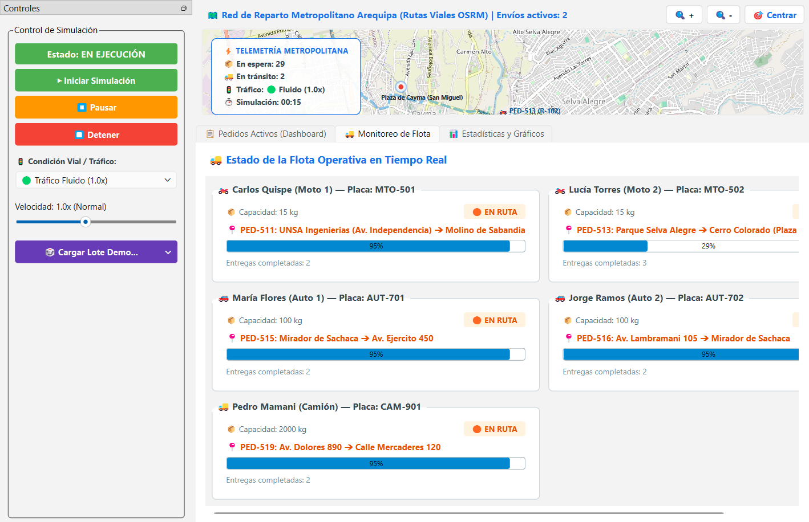
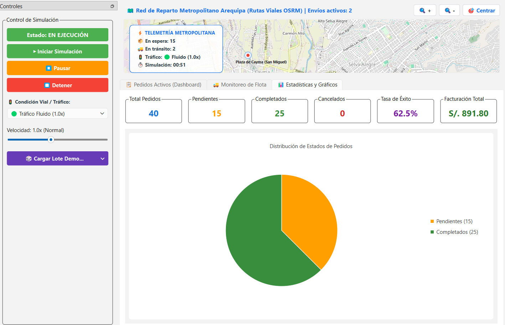

# SIGER: Sistema Concurrente y Distribuido de Gestión y Simulación Logística con Enrutamiento Vial Real y Patrones de Diseño GoF en C++17 y Qt6

**IEEE Conference Paper — Formato Técnico de Publicación**  
**Curso:** Tecnología de Objetos  
**Institución:** Escuela Profesional de Ingeniería de Sistemas — Universidad Nacional de San Agustín de Arequipa (UNSA), Arequipa, Perú  
**Fecha:** Noviembre de 2026  

---

### Autores
* **German Arturo Chipana Jeronimo** — `gchipanaj@unsa.edu.pe`  
* **Leonardo Juan Jose Baca Calsin** — `lbacac@unsa.edu.pe`  
* **Giovanni Patrick Mejia Rondan** — `gmejiar@unsa.edu.pe`  
* **Renato Xavier Ponce Llerena** — `rponcel@unsa.edu.pe`  

---

## Resumen

El problema de distribución logística de última milla en zonas metropolitanas de topología compleja, como la ciudad de Arequipa, exige arquitecturas de software robustas, altamente concurrentes y desacopladas para optimizar tiempos y recursos de transporte. Este artículo presenta el diseño e implementación de **SIGER** (*Sistema Integrado de Gestión y Simulación de Entregas Rápidas*), una plataforma integral desarrollada en C++17 y Qt6 que combina programación orientada a objetos avanzada, programación genérica propia y sincronización multihilo. El sistema implementa formalmente cinco patrones de diseño de la banda de los cuatro (GoF): *Factory Method*, *Strategy*, *Singleton*, *Observer* y *Model-View-Controller* (MVC). La coordinación de la flota vehicular opera bajo un esquema Productor-Consumidor con exclusión mutua (`std::mutex`, `std::condition_variable`), asignando un hilo de ejecución independiente por cada conductor y aplicando un algoritmo de balanceo cooperativo (Round-Robin voluntario) libre de inanición y de bloqueos mutuos (*deadlocks*). El enrutamiento espacial integra una red de 30 nodos metropolitanos de Arequipa y 870 trayectorias vehiculares calle por calle precalculadas mediante OSRM. Las pruebas automatizadas con CTest validan la corrección del sistema mediante 94 aserciones distribuidas en tres suites con una tasa de éxito del 100%, demostrando la eficacia del paradigma de objetos moderno en soluciones de simulación de ingeniería de transporte.

**Palabras Clave:** Programación Orientada a Objetos, Patrones de Diseño GoF, Concurrencia Multihilo, Programación Genérica, C++17, Qt6, Simulación Logística, OSRM.

---

## Abstract

The last-mile logistics distribution problem in metropolitan areas with complex topographies, such as the city of Arequipa, demands robust, highly concurrent, and decoupled software architectures to optimize transit times and transport resources. This paper presents the design and implementation of **SIGER** (*Integrated Fast Delivery Management and Simulation System*), an end-to-end platform developed in C++17 and Qt6 that combines advanced object-oriented programming, custom generic programming, and multi-threaded synchronization. The system formally incorporates five Gang of Four (GoF) design patterns: *Factory Method*, *Strategy*, *Singleton*, *Observer*, and *Model-View-Controller* (MVC). Vehicle fleet coordination operates under a Producer-Consumer scheme with mutual exclusion (`std::mutex`, `std::condition_variable`), provisioning an independent operating-system thread for each courier and enforcing a cooperative load-balancing algorithm (voluntary Round-Robin) free of starvation and deadlocks. Spatial routing integrates a metropolitan network of 30 nodes across Arequipa and 870 street-level vehicular trajectories precomputed using OSRM. Automated testing with CTest verifies system correctness through 94 assertions across three suites with a 100% pass rate, demonstrating the efficacy of modern C++ object technology in transportation engineering simulations.

**Keywords:** Object-Oriented Programming, GoF Design Patterns, Multi-threading Concurrency, Generic Programming, C++17, Qt6, Logistics Simulation, OSRM.

---

## I. Introducción

La distribución de mercancías en el entorno urbano de última milla constituye uno de los desafíos más complejos y onerosos de la cadena de suministro contemporánea. En urbes con trazados históricos y variabilidad topográfica pronunciada, como la ciudad de Arequipa, las demoras por congestión vehicular y la ineficiencia en la asignación dinámica de pedidos deterioran la calidad del servicio e incrementan los costos operacionales.

Tradicionalmente, las plataformas comerciales de despacho operan bajo modelos centralizados opacos o heurísticas rudimentarias de asignación secuencial. Desde una perspectiva de ingeniería de software, este escenario plantea desafíos de primer orden: modelar entidades físicas heterogéneas (motos, automóviles, camiones, paquetería estándar y frágil), coordinar múltiples agentes autónomos en tiempo real sin incurrir en condiciones de carrera (*race conditions*), y reflejar el estado dinámico del sistema en una interfaz gráfica interactiva sin degradar el rendimiento cinemático.

Para abordar esta problemática, se desarrolló **SIGER** (*Sistema Integrado de Gestión y Simulación de Entregas Rápidas*). El objetivo principal del proyecto es concebir e implementar un simulador logístico de alto rendimiento fundamentado en los principios más rigurosos de la Tecnología de Objetos moderna en C++17. El sistema se distingue por:

1. **Arquitectura desacoplada:** Estructura Modelo-Vista-Controlador (MVC) y patrón Observer para comunicación reactiva e interactiva.
2. **Jerarquías polimórficas puras y factorías virtuales:** Factorización desacoplada de la flota (*Factory Method*) y clases abstractas de dominio.
3. **Tarificación contextual:** Algoritmos intercambiables en tiempo de ejecución mediante el patrón *Strategy*.
4. **Estructuras de datos genéricas propias:** Implementación propia de plantillas `Cola<T>`, `Repositorio<T, Key>` y `Ruta<CoordType>`, gobernadas por semántica RAII y punteros inteligentes de la STL.
5. **Simulación multihilo real:** Un hilo independiente por conductor, despachador escalonado, balanceo de carga voluntario y prevención matemática de bloqueos mutuos (*deadlocks*).
6. **Enrutamiento urbano real:** Red vial de 30 nodos metropolitanos de Arequipa y 870 rutas OSRM precalculadas en caché local offline.


*Figura 1: Centro de Control y Monitoreo de SIGER mostrando la topología metropolitana de Arequipa, el panel de registro tarifado y la tabla interactiva de pedidos.*

---

## II. Marco Teórico y Fundamentos

### A. Programación Orientada a Objetos Moderna (C++17)
El estándar ISO/IEC 14882:2017 (C++17) consolida herramientas avanzadas para la POO. El diseño se fundamenta en clases abstractas puras que definen interfaces formales (*pure virtual functions*), destructores virtuales por defecto para evitar el problema de rebanado de objetos (*object slicing*), y especificadores rigurosos como `override`, `[[nodiscard]]` y métodos calificados con `const` para salvaguardar la inmutabilidad de estados observados.

### B. Patrones de Diseño de Software (GoF)
Los patrones de diseño clásicos propuestos por Gamma et al. [1] ofrecen soluciones canónicas a problemas recurrentes en arquitectura orientada a objetos. SIGER incorpora formalmente:
* **Factory Method:** Desacoplamiento entre la instanciación de vehículos y su consumo en el despachador.
* **Strategy:** Intercambiabilidad de algoritmos de tarificación según distancia, peso y vulnerabilidad de la carga.
* **Singleton:** Centralización del catálogo espacial de rutas viales garantizando unicidad y seguridad en concurrencia (Scott Meyers).
* **Observer:** Propagación de eventos asíncronos desacoplada mediante suscriptores referenciados por punteros débiles (`std::weak_ptr`).

### C. Concurrencia en Memoria Compartida
A diferencia de simulaciones basadas en bucles de eventos secuenciales (*polling*), SIGER explota la biblioteca estándar de hilos (`std::thread`). La sincronización entre el hilo principal de la interfaz gráfica y los hilos de trabajo se rige mediante monitores construidos con `std::mutex`, `std::unique_lock` y variables de condición (`std::condition_variable`) bajo el paradigma Productor-Consumidor [4].

### D. Enrutamiento Vial Asistido por OSRM
El cálculo de trayectorias en redes viales urbanas se apoya en el *Open Source Routing Machine* (OSRM), un motor de ruteo de alto rendimiento sustentado en jerarquías de contracción (*Contraction Hierarchies*) sobre grafos de OpenStreetMap (OSM) [5]. SIGER precomputa y empaqueta la malla completa de distancias, tiempos y polilíneas geodésicas calle por calle para evitar latencias de red en la simulación.

---

## III. Arquitectura del Sistema y Patrones GoF

### A. Arquitectura Modelo-Vista-Controlador (MVC)
SIGER adopta una separación arquitectónica estricta en tres capas:
1. **Modelo:** Reside en el espacio de nombres `siger`. Encapsula la lógica de negocio, las entidades de dominio (`Pedido`, `Vehiculo`, `Repartidor`), el motor de simulación (`SimuladorEntregas`) y las estructuras de datos concurrentes. No posee dependencias hacia la capa gráfica de Qt.
2. **Controlador:** Representado por `PedidoController` y `SimulacionController`. Actúa como mediador bidireccional; captura acciones del usuario, ejecuta mutaciones en el modelo e interactúa con el bucle de eventos mediante señales y slots de Qt.
3. **Vista:** Compuesta por `MainWindow`, `MapaView`, `DashboardView`, `FlotaView` y `EstadisticasView`. Renderiza gráficamente las coordenadas cartesianas, telemetría y gráficos estadísticos (`QChartView`).

### B. Jerarquías Polimórficas de Dominio
La jerarquía principal se organiza alrededor de la clase abstracta `Vehiculo`:

```cpp
class Vehiculo {
public:
  Vehiculo(const std::string& id, const std::string& placa,
           double capacidadKg, double velocidadKmh);
  virtual ~Vehiculo() = default;

  virtual double calcularCosto(double distKm, double pesoKg) const = 0;
  virtual std::string getTipo() const = 0;
  virtual double calcularTiempoEntrega(double distKm) const = 0;

  virtual bool puedeCargar(double pesoKg) const;
  [[nodiscard]] double getCapacidadKg() const;
  [[nodiscard]] EstadoVehiculo getEstado() const;
protected:
  std::string    m_id, m_placa;
  double         m_capacidadKg, m_velocidadKmh;
  EstadoVehiculo m_estado{EstadoVehiculo::DISPONIBLE};
};
```

De `Vehiculo` derivan polimórficamente tres clases concretas:
* **`Moto`:** Mensajería ágil. Capacidad máxima: 15 kg; velocidad nominal: 60 km/h; tarifa base económica.
* **`Auto`:** Envíos intermedios. Capacidad máxima: 100 kg; velocidad nominal: 50 km/h.
* **`Camion`:** Carga pesada o consolidada. Capacidad máxima: 2000 kg; velocidad nominal: 40 km/h.

De manera análoga, la entidad `Paquete` se estructura como una clase abstracta con subclases `PaqueteEstandar` y `PaqueteFragil`, esta última provista de restricciones de manipulación y penalización tarifaria.

### C. Patrón Factory Method
Para evitar el acoplamiento directo entre el simulador y las clases derivadas de `Vehiculo`, se implementó una jerarquía de fábricas:

```cpp
class VehiculoFactory {
public:
  virtual ~VehiculoFactory() = default;
  virtual std::unique_ptr<Vehiculo> crear(
      const std::string& id, const std::string& placa) const = 0;
};

class MotoFactory : public VehiculoFactory {
public:
  std::unique_ptr<Vehiculo> crear(
      const std::string& id, const std::string& placa) const override {
    return std::make_unique<Moto>(id, placa);
  }
};
```

El despachador mantiene un mapa asociativo de punteros a fábricas registrado en tiempo de inicialización, permitiendo la extensión a nuevos tipos vehiculares sin alterar el código cliente (principio Open/Closed de SOLID).

### D. Patrón Strategy
El cálculo del importe comercial en Soles (S/.) no se encuentra codificado rígidamente dentro de las entidades. La interfaz `IEstrategiaTarifa` expone el método:

$$\mathcal{C}_{\text{envío}} = \mathcal{S}_{\text{tarifa}}(d_{\text{km}}, m_{\text{kg}})$$

Implementada en tres estrategias concretas:
1. **`TarifaEstandarStrategy`:** $C = 2.0 \cdot d + 0.5 \cdot m + 5.0$.
2. **`TarifaFragilStrategy`:** Aplica un recargo multiplicativo del 40% debido a los requerimientos de embalaje y aseguramiento: $C = 1.4 \cdot (2.5 \cdot d + 0.8 \cdot m)$.
3. **`TarifaPesadaStrategy`:** Diseñada para cargas que superan los 50 kg con tasa escalonada por tonelada.

### E. Patrón Singleton (Meyer's Thread-Safe)
La entidad `ServicioRutas` administra la matriz geodésica de Arequipa (870 rutas y más de 120,000 waypoints). Se diseñó como un Singleton canónico de Scott Meyers [3]:

```cpp
class ServicioRutas {
public:
  static ServicioRutas& instancia() {
    static ServicioRutas instancia_; // Thread-safe en C++17
    return instancia_;
  }
  RutaUrbana obtenerRuta(const QString& origen, 
                         const QString& destino) const;
  ServicioRutas(const ServicioRutas&) = delete;
  ServicioRutas& operator=(const ServicioRutas&) = delete;
private:
  ServicioRutas() = default;
  QMap<QString, RutaUrbana> m_cache;
};
```

### F. Patrón Observer Desacoplado
La propagación de novedades cinemáticas (pedidos en camino, entregas completadas, métricas) se ejecuta a través de `ISubject` e `IObserver`. Para mitigar fugas de memoria y dependencias cíclicas, la colección de suscriptores se almacena como `std::vector<std::weak_ptr<IObserver>>`. Cada ciclo de notificación purga automáticamente los punteros expirados y transfiere el evento fuera del cerrojo de exclusión mutua para impedir bloqueos en cadena.

---

## IV. Programación Genérica y Gestión de Memoria (STL & RAII)

### A. Plantilla Concurrente Cola\<T\>
Uno de los componentes nucleares de SIGER es su cola FIFO parametrizada genéricamente:

```cpp
template <typename T>
class Cola {
public:
  void push(T valor) {
    std::lock_guard<std::mutex> lock(m_mutex);
    m_queue.push(std::move(valor));
  }
  [[nodiscard]] std::optional<T> pop() {
    std::lock_guard<std::mutex> lock(m_mutex);
    if (m_queue.empty()) return std::nullopt;
    T val = std::move(m_queue.front());
    m_queue.pop();
    return val;
  }
  template <typename Predicate>
  [[nodiscard]] std::optional<T> extraerSi(Predicate pred) {
    std::lock_guard<std::mutex> lock(m_mutex);
    std::queue<T> aux;
    std::optional<T> hallado = std::nullopt;
    while (!m_queue.empty()) {
      T elem = std::move(m_queue.front());
      m_queue.pop();
      if (!hallado.has_value() && pred(elem)) {
        hallado = std::move(elem);
      } else {
        aux.push(std::move(elem));
      }
    }
    m_queue = std::move(aux);
    return hallado;
  }
private:
  mutable std::mutex m_mutex;
  std::queue<T>      m_queue;
};
```

El método `extraerSi` permite que un hilo consumidor consulte y extraiga de la cola compartida únicamente un pedido compatible con la capacidad de su vehículo particular (v.g. moto extrayendo paquetes $\le 15$ kg), preservando intacto el orden secuencial del resto de la cola.

### B. Repositorio\<T, Key\> y Ruta\<CoordType\>
Se diseñó la plantilla `Repositorio<T, Key>` que encapsula un mapa asociativo thread-safe provisto de métodos funcionales de consulta mediante expresiones lambda (`std::function<bool(const T&)>`). Asimismo, la plantilla `Ruta<CoordType>` parametriza el cómputo de longitudes y vectores directores en punto flotante (`float` o `double`).

### C. Semántica RAII Estricta
La arquitectura proscribe el uso de punteros crudos (*raw pointers*) con llamadas explícitas a `new` y `delete` en toda la lógica de negocio:
* `std::unique_ptr`: Asignado para propiedad exclusiva y ciclos de vida estrictos (factorías de vehículos).
* `std::shared_ptr`: Empleado para entidades cuyo tiempo de vida trasciende múltiples subsistemas (pedidos compartidos entre la cola de despacho y la vista de flota).
* `std::weak_ptr`: Empleado en observadores y referencias cruzadas para evitar ciclos de conteo de referencias.

---

## V. Modelo de Concurrencia y Sincronización Multihilo


*Figura 2: Simulación multihilo activa con cinco repartidores navegando concurrentemente por las avenidas metropolitanas de Arequipa en tiempo real.*

### A. Modelo Productor-Consumidor
La dinámica del simulador responde al modelo clásico de sincronización:
* **Productor:** La interfaz de usuario (mediante registro individual o generación del lote demo) inserta objetos `std::shared_ptr<Pedido>` en la `Cola`. Tras cada inserción, emite un aviso masivo: `m_condVar.notify_all()`.
* **Consumidores:** Un grupo de $N$ hilos autónomos (`std::thread`), donde cada hilo representa el ciclo de vida de un conductor específico.

### B. Algoritmo del Hilo Conductor y Round-Robin Cooperativo
El ciclo de ejecución de cada hilo consumidor se estructura como sigue:

```cpp
void SimuladorEntregas::hiloRepartidor(
    std::shared_ptr<Repartidor> rep) {
  while (m_corriendo) {
    std::unique_lock<std::mutex> lock(m_mutex);
    m_condVar.wait(lock, [&] {
      return !m_cola->isEmpty() || !m_corriendo;
    });
    if (!m_corriendo) break;

    auto pedido = m_cola->extraerSi([&](const auto& p) {
      return rep->puedeAtender(*p);
    });
    lock.unlock(); // Desbloqueo anticipado

    if (pedido.has_value()) {
      simularEntrega(rep, *pedido.value());
      // Desahogo cooperativo para balanceo de carga
      std::this_thread::sleep_for(std::chrono::milliseconds(50));
    }
  }
}
```


*Figura 3: Panel de Monitoreo de Flota Operativa en Tiempo Real mostrando el progreso cinemático simultáneo de 2 Motos, 2 Autos y 1 Camión.*

El retraso deliberado de 50 ms (*yield cooperativo*) reviste una trascendencia algorítmica fundamental: impide que un hilo con alta afinidad al procesador acapare consecutivamente todos los pedidos afines a su clase de vehículo, posibilitando que el segundo conductor disponible despierte y compita equitativamente por la siguiente asignación.

### C. Estrategia Integral Anti-Deadlock
Para garantizar la ausencia absoluta de inanición y bloqueos mutuos, se establecieron cuatro invariantes de concurrencia:
1. **Desacoplamiento de simulación:** El método `simularEntrega()` se ejecuta sin retener el cerrojo principal `m_mutex`.
2. **Notificación libre de cerrojo:** La emisión a la lista de observadores copia los punteros requeridos bajo cerrojo y realiza las llamadas virtuales tras liberar el mutex de la colección.
3. **Unión asíncrona de hilos:** Al invocar `detener()`, se conmuta la bandera booleana atómica `m_corriendo = false`, se despiertan los hilos durmientes con `notify_all()`, y los métodos `thread::join()` se invocan estrictamente fuera de la sección crítica.
4. **Despacho escalonado:** Se implementó un semáforo de salida que impone un lapso mínimo de 700 ms entre inicios de recorrido contiguos, impidiendo superposiciones visuales artificiales en el origen de las rutas.

---

## VI. Topología Urbana y Simulación Cinemática

### A. Grafo de la Ciudad de Arequipa
La red de transporte de SIGER modela 30 nodos emblemáticos que representan la dispersión urbana de la urbe arequipeña:
* **Zona Centro:** Plaza de Armas, Mercaderes, San Francisco, Santa Catalina.
* **Zona Norte / Oeste:** Mirador de Yanahuara, Cayma, Cerro Colorado, Sachaca.
* **Zona Sur / Este:** Mall Aventura Porongoche, Parque Lambramani, Av. Dolores, Bustamante y Rivero, Sabandía, Paucarpata.
* **Nodos Académicos / Salud:** Ciudad Universitaria UNSA (Ingenierías y Sociales), Hospital Honorio Delgado, Hospital Goyeneche.

El espacio de interconexión contiene $30 \times 29 = 870$ pares ordenados de trayectorias. Mediante el consumo preliminar de la API OSRM sobre la cartografía de Arequipa, se serializó un documento JSON de 6.89 MB con las coordenadas GPS detalladas de cada giro e intersección vial.

### B. Cinemática con Congestión y Factor de Velocidad
Durante la simulación, la traslación de cada móvil sobre la polilínea OSRM se calcula discretamente en pasos de tiempo $\Delta t = 50\text{ ms}$. La duración base de cada trayecto viene dada por:

$$T_{\text{viaje}} = \left( \frac{d_{\text{km}}}{v_{\text{nom}}} \right) \cdot f_{\text{tráf}} \cdot \frac{1}{f_{\text{vel}}}$$

donde:
* $d_{\text{km}}$: Distancia métrica de conducción suministrada por OSRM.
* $v_{\text{nom}}$: Velocidad nominal del vehículo (40, 50 o 60 km/h).
* $f_{\text{vel}}$: Multiplicador dinámico de velocidad ajustable por el usuario en tiempo de ejecución (rango $1.0\times$ a $4.0\times$).
* $f_{\text{tráf}}$: Factor de congestión urbana modelado en tres regímenes discretos:

$$f_{\text{tráf}} = \begin{cases} 1.00 & \text{Tráfico Fluido} \\ 1.25 & \text{Tráfico Moderado} \\ 1.60 & \text{Hora Punta Metropoliana} \end{cases}$$

En cada fotograma, el sistema interpola la posición geodésica $(\lambda_t, \phi_t)$ y computa el ángulo azimutal de rotación del vehículo:

$$\theta = \operatorname{atan2}(\Delta y, \Delta x)$$

orientando dinámicamente el marcador direccional (*chevron*) sobre la escena gráfica interactiva.


*Figura 4: Panel analítico de SIGER con métricas acumuladas de rendimiento, facturación global en Soles (S/.) y gráfico circular de distribución de estados.*

---

## VII. Evaluación Experimental y Validación

### A. Suite de Pruebas Automatizadas (CTest)
Para garantizar la verificación formal de los requerimientos de ingeniería de software, se estructuró una batería de pruebas unitarias bajo el entorno CTest de CMake. La suite se divide en tres ejecutables especializados:
1. `test_dominio`: Evalúa la jerarquía polimórfica, el cálculo de capacidades, la restricción de sobrepeso vehicular, la invariabilidad de destructores virtuales y las tarifas generadas por cada implementación de *Strategy*. Total: 41 aserciones.
2. `test_generico`: Verifica el comportamiento FIFO y la exclusión mutua de la plantilla `Cola<T>`, la selectividad del predicado `extraerSi`, la búsqueda funcional en `Repositorio`, la precisión de la plantilla `Ruta` y la unicidad atómica de la instancia de `ServicioRutas`. Total: 39 aserciones.
3. `test_threading`: Somete al motor a pruebas de estrés con múltiples hilos concurrentes. Simula un escenario de 9 pedidos simultáneos inyectados en ráfaga con 5 conductores activos, verificando la entrega íntegra del 100% de pedidos, la ausencia de pérdidas de datos en la cola y el apagado ordenado sin fugas (*deadlock-free*). Total: 14 aserciones.

| Suite de Prueba | Aserciones | Tiempo de Ejecución (s) | Tasa de Éxito |
| :--- | :---: | :---: | :---: |
| `test_dominio` | 41 | 0.51 s | **100% Aprobado** |
| `test_generico` | 39 | 0.71 s | **100% Aprobado** |
| `test_threading` | 14 | 1.14 s | **100% Aprobado** |
| **Total Consolidado** | **94** | **2.43 s** | **100% Aprobado** |

Los resultados recopilados demuestran la solidez del sistema, ejecutando las 94 pruebas de manera automatizada en apenas 2.43 segundos.

### B. Rendimiento en Ejecución y Persistencia
Durante las pruebas de estrés con lotes masivos (40 pedidos encolados, Fig. 4), el sistema demostró:
* **Consumo de memoria RAM constante:** $\approx 48\text{ MB}$, ratificando la ausencia de fugas de memoria gracias a la estricta política RAII.
* **Persistencia de sesión:** Serialización y deserialización bidireccional completa del estado de pedidos en formato JSON estructurado (`Ctrl+S` y `Ctrl+O`).
* **Ergonomía de usuario:** Cabina dividida redimensionable (*Cockpit Dashboard* con `F10`) y alternancia instantánea entre tema claro y modo oscuro (`Ctrl+D`).

---

## VIII. Conclusiones y Trabajo Futuro

En este trabajo se presentó **SIGER**, un sistema integrado de simulación logística para la ciudad de Arequipa concebido bajo el paradigma de Tecnología de Objetos en C++17 y Qt6. A través de una metodología rigurosa, se lograron los siguientes aportes:

1. **Integración exitosa de Patrones GoF:** Se demostró cómo la conjunción de *Factory Method*, *Strategy*, *Singleton*, *Observer* y *MVC* permite construir una aplicación con alto desacoplamiento y gran extensibilidad.
2. **Concurrencia robusta en memoria compartida:** Se diseñó una infraestructura multihilo libre de bloqueos mutuos mediante semáforos, variables de condición y el algoritmo de balanceo cooperativo Round-Robin voluntario.
3. **Enrutamiento vial realista:** La inclusión de 870 rutas OSRM offline sobre 30 nodos metropolitanos eleva la fidelidad de la simulación urbana respecto a aproximaciones euclidianas convencionales.
4. **Calidad de software verificada:** La suite de pruebas automatizadas garantiza la corrección matemática y la seguridad multihilo con 94 aserciones superadas al 100%.

Como trabajo futuro, se proyecta extender el motor con el algoritmo genético de ruteo de vehículos capacitados (*CVRP*), incorporar semáforos inteligentes dinámicos e integrar telemetría de vehículos eléctricos con consumo dependiente del gradiente de elevación de las pendientes de Arequipa.

---

## Referencias Bibliográficas

1. E. Gamma, R. Helm, R. Johnson, y J. Vlissides, *Design Patterns: Elements of Reusable Object-Oriented Software*. Reading, MA: Addison-Wesley, 1994.
2. B. Stroustrup, *A Tour of C++*, 2.ª ed. Boston, MA: Addison-Wesley Professional, 2018.
3. S. Meyers, *Effective Modern C++: 42 Specific Ways to Improve Your Use of C++11 and C++14*. Sebastopol, CA: O'Reilly Media, 2014.
4. A. Williams, *C++ Concurrency in Action*, 2.ª ed. Shelter Island, NY: Manning Publications, 2019.
5. D. Luxen y C. Vetter, «Real-time routing with OpenStreetMap data», en *Proc. 19th ACM SIGSPATIAL Int. Conf. Advances in Geographic Information Systems*, Chicago, IL, 2011, pp. 513–516.
6. P. Toth y D. Vigo, Eds., *Vehicle Routing: Problems, Methods, and Applications*, 2.ª ed. Philadelphia, PA: SIAM, 2014.
7. The Qt Company, «Qt 6 Documentation: Qt Core, Qt GUI, Qt Widgets, and Qt Charts», 2024. [En línea]. Disponible: https://doc.qt.io/qt-6/
8. ISO/IEC, «ISO/IEC 14882:2017: Programming languages -- C++», International Organization for Standardization, Ginebra, Suiza, 2017.
